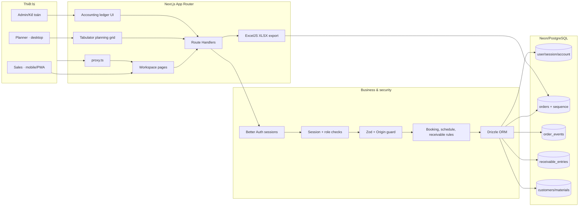

# Kiến trúc

## Mục tiêu
Một Next.js web app responsive dùng chung trên desktop và điện thoại. Nhân viên kinh doanh tạo booking; kế hoạch xác nhận, xếp giờ, gán xe; Admin quản lý tài khoản. Điện thoại có thể cài PWA. Kế toán/Admin có sổ ghi khoản phải thu và thu tiền cơ bản.

## Stack
- Next.js App Router trên Vercel.
- Better Auth cho email/mật khẩu và session; signup công khai tắt.
- Drizzle ORM + PostgreSQL trên Neon; sequence ở database cấp mã booking không trùng khi nhiều người tạo cùng lúc.
- Tabulator làm lưới kế hoạch kiểu spreadsheet; ExcelJS xuất `.xlsx` chuẩn.
- Zod xác thực payload API; vai trò được kiểm tra ở server/API.

## Luồng request
```text
Mobile/Desktop Browser
        │
        ├─ Next.js pages / PWA shell
        ├─ Better Auth session ──┐
        └─ API routes            │
              │                 │
              └── RBAC + Zod ───┴── Drizzle ── Neon PostgreSQL
                                   ├─ orders / booking sequence
                                   ├─ customers / materials / app_settings catalogs
                                   ├─ order_events audit trail
                                   ├─ receivable_entries append-only ledger
                                   ├─ usage_events (ước lượng client-side)
                                   ├─ admin_audit_events
                                   └─ Better Auth user/session/account
```

## Sơ đồ cấu trúc repository

```text
src/
├─ app/                         Next.js pages, layouts và Route Handlers
│  ├─ (workspace)/              orders, receiving, planning, reports, customers, admin, technical, accounting
│  └─ api/                      auth, orders, catalog, telemetry, audit events, XLSX, health, accounting
├─ components/                  workspace, lưới booking, danh mục, giám sát, sổ công nợ, PWA
├─ db/                          Drizzle connection pool và schema PostgreSQL
├─ lib/                         auth/session, RBAC, validation, lịch, XLSX, logging
├─ proxy.ts                     chặn/điều hướng request trước khi render page
└─ types/                       khai báo type bổ sung

drizzle/                        SQL migrations 0000–0009
scripts/                        migrate DB, tạo Admin, seed demo, smoke/cleanup
tests/                          unit tests cho nghiệp vụ, ngày, XLSX, bảo vệ request
public/                         manifest, icons, service worker, offline shell
docs/                           kiến trúc, mô hình dữ liệu, đánh giá nền, kế hoạch
.github/workflows/              quality gate cho PR và cập nhật main/develop
```



### Khoảng trống còn lại

- Chưa có kiểm thử browser E2E tự động đăng nhập và thao tác theo từng vai trò; UAT thủ công đã xác nhận luồng NVKD → Kế hoạch → Admin trên Preview cô lập và local PostgreSQL.
- Neon Preview cô lập `cencom-preview-isolated` đã được cấu hình riêng; migration `0000`–`0010` đã có trên DB này, dry-run tường minh không ghi dữ liệu. Dashboard và Vercel API read-only xác nhận Preview hostname `kdbt-app-dat-hang-d3p3i4sxy-vohanh19902026-droid.vercel.app`, deployment `dpl_6LUB6QziC5iQqut8cGiecVHMKNyo`, commit `ca9dce2` đang `READY`. Không dùng Neon `main`/Production cho UAT.
- Browser phiên đăng nhập bình thường xác nhận 20 GET `/api/health` qua 10 tab/2 chu kỳ, 20/20 JSON `status: ok` và DB up; endpoint báo p50/p95 228 ms, max 1.610 ms. Tổng 16,42 giây gồm điều phối/đọc UI; đây chưa phải load test liên tục hay thông lượng Vercel đáng tin cậy. Harness dùng OIDC Trusted Sources trả trang Login HTML HTTP 200 nên bị loại; harness hiện kiểm tra body JSON và chỉ nhận URL Preview allowlist. Cần phương thức tải được duyệt; không dùng cookie, `vercel curl`, share link hay giảm Deployment Protection.
- Cần workbook Excel gốc để nghiệm thu chính xác độ rộng cột/màu/in trang; hiện chỉ có ảnh tham khảo.
- Sổ kế toán mới là nhật ký phải thu/thu tiền, chưa có hóa đơn, đối soát hoặc chứng từ giao từng chuyến. PWA chưa hỗ trợ nhập liệu offline. Web Push đã triển khai nhưng chưa xác minh gửi/nhận vì quyền trình duyệt chưa cấp và chưa thử trên thiết bị Android thật.
- PITR/backup Production hiện chỉ được xác minh ở mức thông tin cấu hình; chưa có snapshot/restore drill phù hợp RPO, và rollback Vercel chưa diễn tập.

## Ranh giới triển khai
- Pages/middleware không thay thế bảo vệ API: API tự xác minh session, vai trò và trạng thái tài khoản.
- Kinh doanh chỉ đọc booking do mình tạo; Kế hoạch/Admin thao tác toàn bộ lệnh.
- Bảng kế hoạch, báo cáo và tệp XLSX lọc theo ngày cấp hàng `COALESCE(planned_start_at, requested_at)`; đơn chưa xếp lịch nằm ở ngày yêu cầu.
- Mỗi cập nhật kế hoạch ghi audit event trong cùng transaction với đơn. Cột `version` ngăn cập nhật đè lên phiên bản mới hơn; trình duyệt gửi version hiện tại khi lưu.
- Service worker chỉ dự phòng offline screen/icon, không cache trang riêng hoặc API.
- API ghi dữ liệu kiểm tra Origin; production bật CSP cùng các security header cơ bản, API trả `Cache-Control: no-store`.
- Auth endpoint sign-in/email giới hạn 5 lần/phút với storage in-memory mặc định; giới hạn tính theo instance serverless, nên cần shared storage nếu mở rộng quy mô.
- Tab Hệ thống tổng hợp lượt xem từ telemetry client và phép đo query DB tại thời điểm tải; số byte là ước lượng từ browser, không phải Vercel CDN egress chính thức.
- Sổ công nợ chỉ mở cho `ADMIN`/`ACCOUNTANT`; API tự xác thực session/RBAC/Origin, số tiền là integer VND, bút toán append-only. Backend errors log JSON đã lược thông tin nhạy cảm.
- Chưa lưu giá bê tông, tự động lập phải thu từ đơn hàng, hóa đơn hoặc khối lượng giao từng chuyến.

## Triển khai
Cấu hình `DATABASE_URL`, `BETTER_AUTH_SECRET`, `BETTER_AUTH_URL`; chạy schema SQL/Drizzle push một lần trên database trống; tạo Admin; deploy Next.js lên Vercel. Xem `README.md`.
